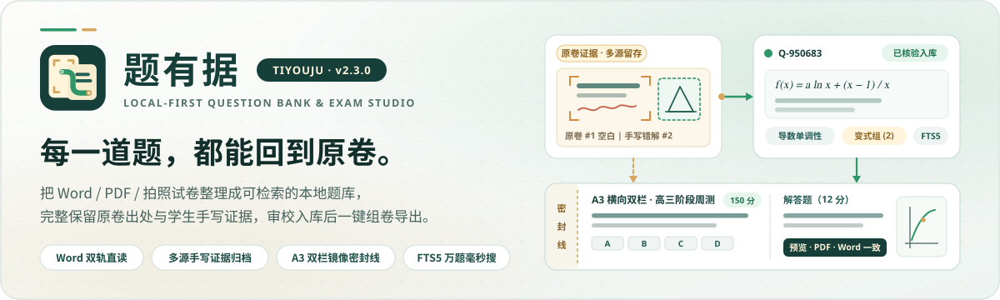
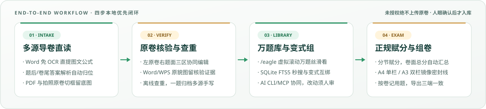
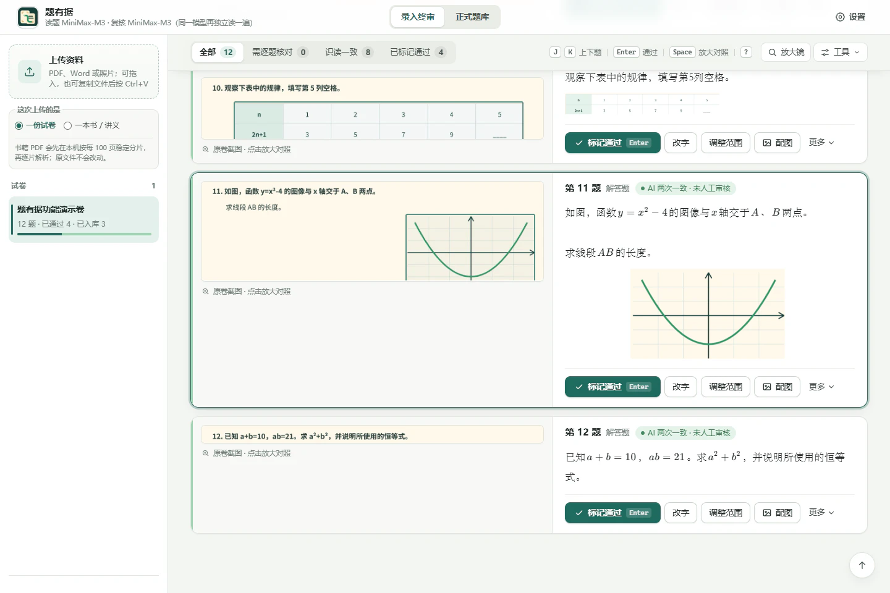
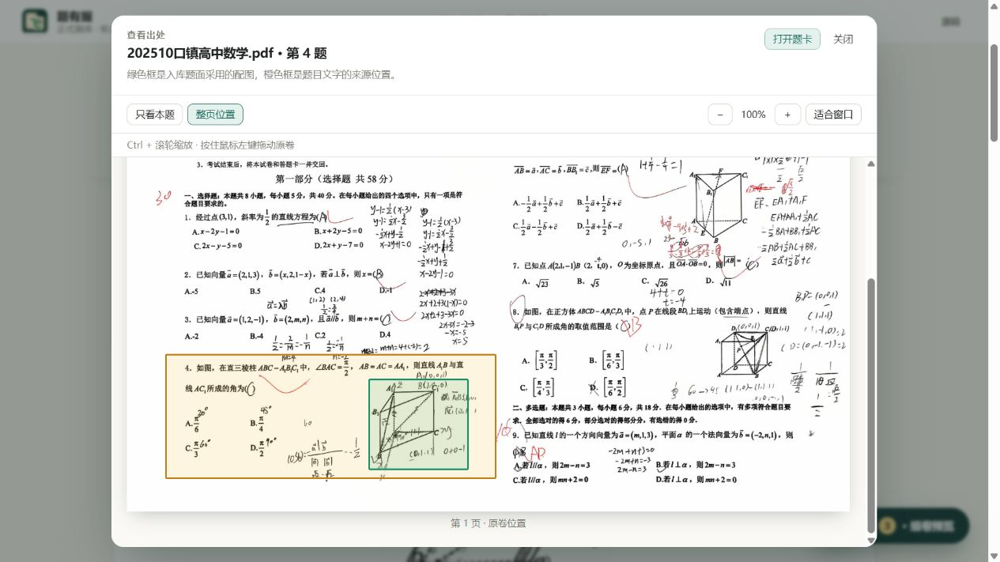
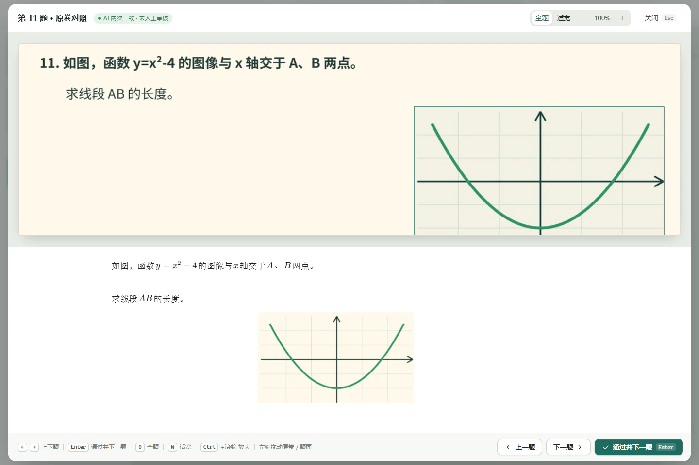
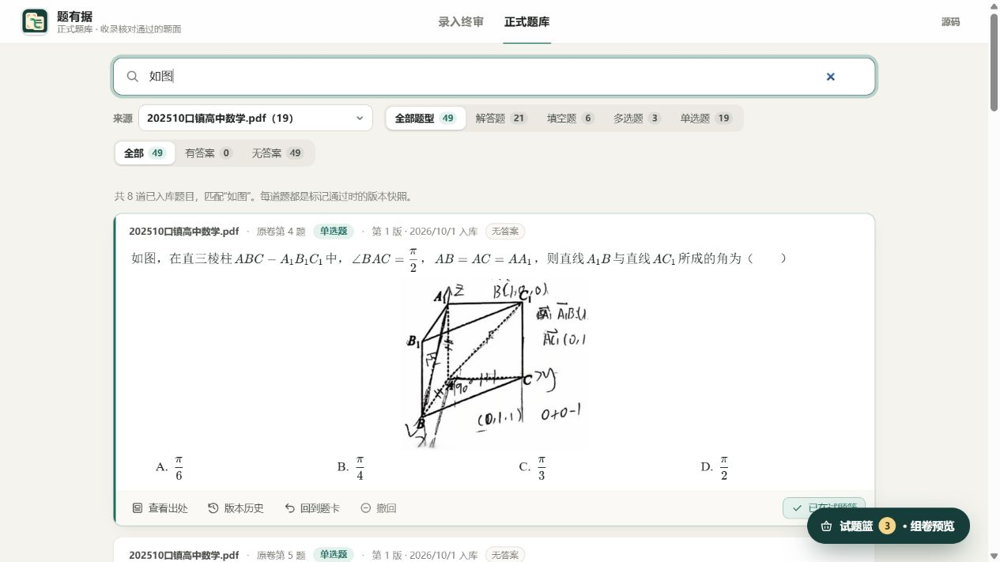
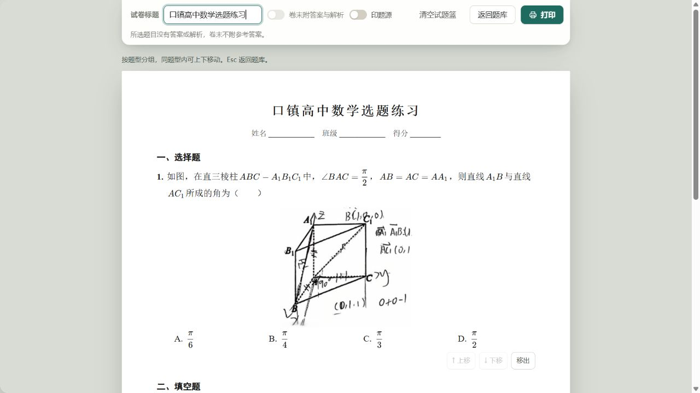

<p align="center">
  <picture>
    <source media="(prefers-color-scheme: dark)" srcset="docs/assets/brand/readme-hero-dark.svg" />
    <source media="(prefers-color-scheme: light)" srcset="docs/assets/brand/readme-hero-light.svg" />
    
  </picture>
</p>

<p align="center">
  <a href="https://github.com/CEHNICA/question-bank-card/releases/latest">
    
  </a>
  
  <a href="LICENSE">
    
  </a>
  
  <a href="AGENTS.md">
    
  </a>
</p>

<p align="center">
  <a href="https://github.com/CEHNICA/question-bank-card/releases/latest"><strong>下载 Windows 安装版</strong></a>
  &nbsp;·&nbsp;
  <a href="#try-demo"><strong>不用密钥先练一遍</strong></a>
  &nbsp;·&nbsp;
  <a href="docs/使用指南.md">安装与使用指南</a>
  &nbsp;·&nbsp;
  <a href="AGENTS.md">AI 助手协同</a>
  &nbsp;·&nbsp;
  <a href="CHANGELOG.md">完整更新记录</a>
</p>

> **面向数学教师与教研场景的本地优先题库与正规组卷工作台（Windows 10 / 11）**
>
> 把 Word 试卷、PDF 扫描件或手写错题照片整理成可检索的结构化题库——**每一道题都保留原卷出处与学生手写证据，人工核验后才入库，组卷预览、PDF 与 Word 三端一致。**

---

## 核心能力 · `v2.3.0`

<table>
  <tr>
    <td width="50%" valign="top">
      <h4>Word（.docx / .doc）双轨直读与答案同拆</h4>
      <p>直接打开 <code>.docx</code> 免 OCR 秒提题干、OMML / 常见 MathType 公式与内嵌图片（本机有 Word / WPS 时自动静默转换兼容老版 <code>.doc</code>）。自动剥离紧跟题后或卷尾的【答案】【解析】及配图，并在后台由本机办公软件静默渲染原貌 PDF 留作「核验证据」。</p>
    </td>
    <td width="50%" valign="top">
      <h4>离线查重、一题多源证据归档与变式题组</h4>
      <p>纯本机毫秒级识别重复原题与换皮变式，并在「录题审核页」和 <code>/eagle</code>「全库查重整理」就地提醒。合并重复题时，题库列表只保留唯一干净题卡，历次空白原卷与不同学生的手写错解则追加挂进「核验证据」多标签栏；变式题可互绑并在出卷时一键替换。</p>
    </td>
  </tr>
  <tr>
    <td width="50%" valign="top">
      <h4>考卷赋分、A3 双栏密封线与用题防撞车</h4>
      <p>支持单题/分节赋分与总分自动汇总，新增 <strong>A4 单栏</strong> 与 <strong>标准 A3 横向双栏（奇偶页自动镜像密封线）</strong> 双规格。按整份考卷自动合并记账「历史用题」，支持「排除近期已用题」防止周测撞车，确保屏幕预览、PDF 与 Word 排版严丝合缝。</p>
    </td>
    <td width="50%" valign="top">
      <h4>/eagle 万题级虚拟滚动与 SQLite FTS5 秒搜</h4>
      <p>内置连续丝滑虚拟滚动与 KaTeX 公式 HTML 缓存，快速拖动滚动条不掉帧、支持实时题序跳转与跨可视区全选；配合 SQLite FTS5 中英文及公式全文索引与 2,000+ 题按需分段流式加载，上万题依旧秒开秒搜。</p>
    </td>
  </tr>
  <tr>
    <td width="50%" valign="top">
      <h4>全屏三区编辑、A–H 选项与 OneNote 联动</h4>
      <p>左侧高清原卷灯箱对照、中间编辑题干/选项与默认展开的答案解析、右侧实时公式与光标同步预览。选择题支持扩展至 <code>A–H</code> 八选项及对应配图槽位，支持单题跳转 OneNote 做题页与深链回跳。</p>
    </td>
    <td width="50%" valign="top">
      <h4>AI 助手 CLI / MCP 协同与人审防线</h4>
      <p>内置 <code>tiyouju</code> 命令行与 MCP 工具，可交由豆包、Claude Code、Codex 或 Cursor 探查原卷、归纳教辅章节、起草答案与标签建议；但 AI 助手永远无法跳过人工核对私自覆盖已通过的题面，最终入库拍板始终归老师。</p>
    </td>
  </tr>
</table>

> 详细变更请查看 [v2.3.0 更新说明](docs/release-notes-v2.3.0.md) 与 [CHANGELOG.md](CHANGELOG.md)。

---

## 端到端本地闭环

<p align="center">
  <picture>
    <source media="(prefers-color-scheme: dark)" srcset="docs/assets/brand/readme-workflow-dark.svg" />
    <source media="(prefers-color-scheme: light)" srcset="docs/assets/brand/readme-workflow-light.svg" />
     原卷核验与查重 -> 万题库与变式组 -> 正规赋分与组卷" />
  </picture>
</p>

---

## 真实界面一览

<p align="center">
  
</p>
<p align="center">
  <sub>实际运行界面（<code>202510口镇高中数学.pdf</code> 第 4 题）：左侧保留真实手写演算与原卷对照，右侧完成题面与配图整理，核对后一键入库。</sub>
</p>

<table>
  <tr>
    <td width="50%" align="center" valign="top">
      <br />
      <sub><strong>原卷出处定位</strong>：橙框标出文字范围、绿框标出配图裁剪，随时一秒回到原卷页。</sub>
    </td>
    <td width="50%" align="center" valign="top">
      <br />
      <sub><strong>高清并排核对</strong>：支持 Ctrl + 滚轮缩放、两点定框裁剪与框选局部识读。</sub>
    </td>
  </tr>
  <tr>
    <td width="50%" align="center" valign="top">
      <br />
      <sub><strong>题库筛选与试题篮</strong>：多维标签目录、全文检索、智能文件夹与批量选题篮。</sub>
    </td>
    <td width="50%" align="center" valign="top">
      <br />
      <sub><strong>所见即所得组卷预览</strong>：支持分节赋分、A4 / A3 双栏密封线与 PDF / Word 一致导出。</sub>
    </td>
  </tr>
</table>

<p align="right">
  <sub>以上截图均采自本机实跑环境，原始数据与隐私脱敏说明见 <a href="docs/assets/screenshots/README.md">截图与演示说明</a>。</sub>
</p>

---

## 快速开始

### 1. Windows 安装与启动

- **图形安装版 / 便携版**：前往 [GitHub Releases](https://github.com/CEHNICA/question-bank-card/releases/latest) 下载 `TiYouJu-Setup-2.3.0.exe`（推荐）或免安装便携压缩包 `QuestionBankCard-2.3.0-portable.zip`。
- **PowerShell 一行安装**：

```powershell
irm https://github.com/CEHNICA/question-bank-card/releases/latest/download/install.ps1 | iex
```

完整配置说明见 [安装与使用指南](docs/使用指南.md)（[安装与服务配置](docs/使用指南.md#安装与服务配置) · [组卷打印与 Word 导出](docs/使用指南.md#组卷打印与-word-导出)）。

<a id="try-demo"></a>

### 2. 不用密钥，3 分钟零成本体验

安装后直接点击 **「手工切题练习（不用密钥）」**（或进入 **设置 → 帮助 → 开始手工练习**），即可用内置示例走通「拉框切题 → 编辑公式 → 审核入库 → 选题导出 PDF」完整流程，不联网、不写正式题库、不消耗任何额度。也可导入仓库内置的 [原创三页演示卷](docs/demo/tiyouju-demo-paper.pdf)（[生成与字体说明](docs/demo/README.md)）实测完整导卷。

### 3. 配合 AI 助手一起用（豆包 / Claude Code / Codex / Cursor）

安装器会自动配置 `tiyouju` 命令行与主流编程助手技能目录：

- **交给豆包**：把本仓库地址 `https://github.com/CEHNICA/question-bank-card` 发给豆包，即可按文档带你安装和核对题目，参见 [先用豆包帮你核对](docs/使用指南.md#先用豆包帮你核对)。
- **交给本地智能体**：桌面版已自动接入 `tiyouju` CLI / MCP 工具链；在未配置云端 API 密钥时，也能由当前助手完成切题辅助、参考答案初稿与标签建议（详见 [AGENTS.md](AGENTS.md)）。

---

## 本地优先与隐私边界

题有据的服务默认仅监听本机回环端口，题库数据库与原卷原图完全存储在本地磁盘；**没有任何默认后台上传行为**。

| 处理环节 | 数据流向 | 说明 |
| --- | --- | --- |
| **Word 双轨直读、本地查重、FTS5 检索、组卷导出** | 100% 本机离线 | 不连接外网；本机装有 Word / WPS 时在本地静默生成原貌 PDF 核验证据 |
| **手工框题与原图入库** | 100% 本机离线 | 无需 OCR 或 API 密钥即可完成切框、入库、按出处检索与导出 |
| **MinerU 云端自动切题** | 显式授权后上传当前 PDF | 仅在用户主动选择云解析时发送至 MinerU（限制见 [MINERU_API.md](docs/MINERU_API.md)） |
| **看图读题 / 推荐答案 / 标签建议** | 显式点击后发送单题 | 仅发送所选题目截图或题干到用户自选模型接口，密钥经 Windows DPAPI 加密保存 |

更多细节与目录结构请参阅 [API 与隐私边界](docs/使用指南.md#api-与隐私边界)。

---

## 开发者信息与版本索引

<details>
<summary><strong>技术栈与核心模块架构</strong></summary>

- **桌面封装与启动**：Python 3.12 · Win32 原生窗口集成（`app_launcher.pyw` / `app_window.py`）· PyInstaller + Inno Setup 7 · `tiyouju` CLI / MCP Server（`tiyouju_cli.py`）
- **后端引擎**：Django + SQLite（WAL + `FTS5` 倒排索引 `core_publishedquestion_fts`）· PyMuPDF · `python-docx` · Word OMML / MathType MTEF 公式解析（`word_extract.py` / `word_omml.py` / `word_mtef.py`）· 离线查重与多源归档（`library_similarity.py`）· 考卷导出与用题记账（`library_pdf.py` / `library_export.py` / `library_usage.py`）
- **前端工作台**：零构建原生态模块化 JS（ESLint 严格校验）· 连续虚拟滚动（`eagle-virtual-list.js`）· KaTeX 数学排版 · 所见即所得分栏分页引擎（`exam-layout.js` / `exam-export.js`）· 全屏三区统一编辑台（`library-unified-editor.js`）

</details>

<details>
<summary><strong>从源码运行、构建与测试门禁</strong></summary>

完整环境搭建、依赖锁定与打包审计流程见 [开发环境说明](docs/开发环境.md) 与 [从源码运行与测试](docs/使用指南.md#从源码运行与测试)。

```powershell
# 一键运行全部静态检查（ruff / eslint / mypy）、Django 迁移校验及前后端 + 桌面全量测试
.\dev.ps1 -Task check

# 本地构建隔离打包目录与 Inno Setup 安装包（需与 backend/core/version.py 一致）
.\dev.ps1 -Task build -Version 2.3.0
```

</details>

<details>
<summary><strong>重要里程碑版本速查</strong></summary>

- **2.3.0** — Word 双轨直读与答案同拆、Eagle 虚拟滚动、本地查重与一题多源手写证据归档、A3 双栏镜像密封线考卷及 FTS5 万题检索 · [更新说明](docs/release-notes-v2.3.0.md)
- **2.2.11** — 统一全屏三区「编辑」工作台、选项扩展至 `A–H`、AI 推荐答案与 0 题待切引导 · [更新说明](docs/release-notes-v2.2.11.md)
- **2.2.0** — 导出 Word 像素级对齐打印预览、按卷/目录打包分享与 OneNote 回跳加固 · [更新说明](docs/release-notes-v2.2.0.md)
- **2.1.0** — 常驻分屏原卷画布双向联动、拍照旋图暂存、共享 API 串行队列 · [更新说明](docs/release-notes-v2.1.0.md)
- **2.0.0** — Eagle 级题库工作台上线、统一解析编辑器、Word/PDF 导出对齐与索引加固 · [更新说明](docs/release-notes-v2.0.0.md)

完整逐版历史请参阅 [CHANGELOG.md](CHANGELOG.md)。

</details>

---

## 反馈、贡献与许可

- [提交问题或功能建议](https://github.com/CEHNICA/question-bank-card/issues) · [参与贡献](CONTRIBUTING.md) · [报告安全问题](SECURITY.md)
- 开源协议：[AGPL-3.0-only 许可证](LICENSE) · [第三方组件与字体许可说明](packaging/THIRD_PARTY_NOTICES.txt)

> 提交公开 Issue 或讨论时，请勿附带真实学生姓名/手写个人隐私信息、本地题库 `.sqlite3`、运行日志或任何 API 密钥。
