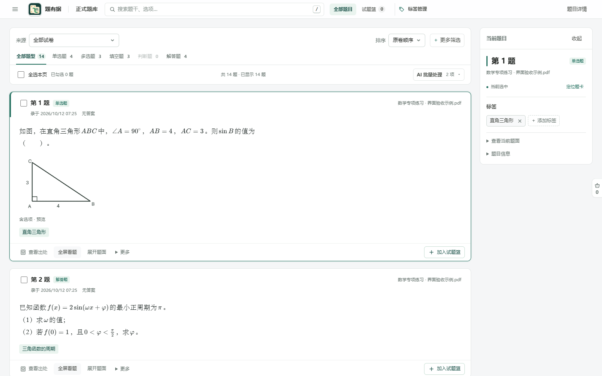
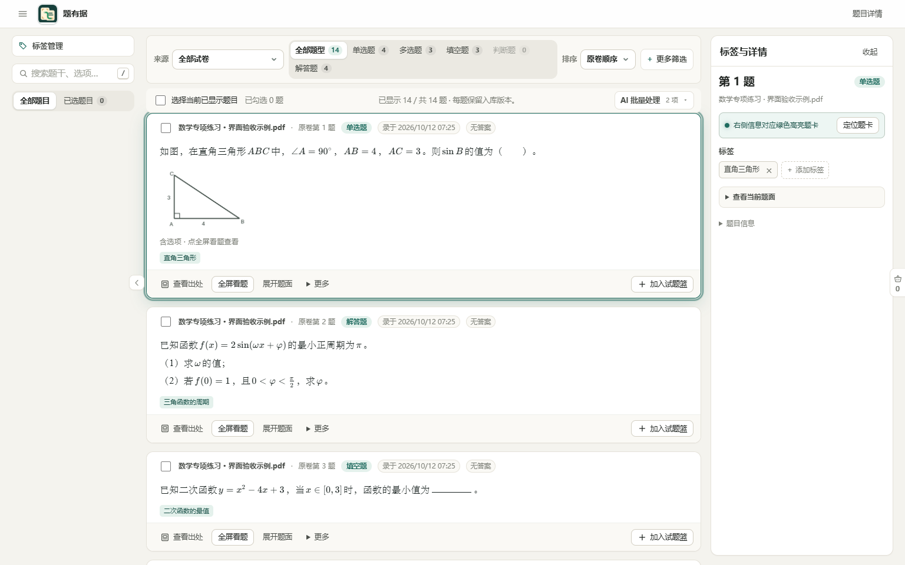
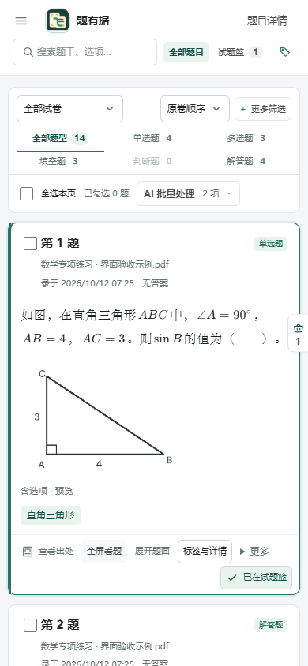

# 正式题库界面改进

日期：2026-10-12。基于 1.21.0 当前源码，完成真实题库页面的布局改进和隔离验收。本轮没有生成新的安装包，没有升级已安装程序。

## 判断

原界面的主要问题是信息层次失衡：题型按钮被挤到第二行，筛选和勾选操作像两块互不相关的灰色面板；每个来源、时间和状态都接近同一强调程度；题目没有明确的标题；绿色高亮叠了描边与多层阴影；右栏固定铺满屏幕，但多数时候只有很少的信息。

根据后续反馈，查找与导航搬到顶部，中间阅读、右侧处理当前题。左侧栏不再常驻。参考 [Eagle 4.0 对标签输入和管理交互的整理](https://cn.eagle.cool/blog/post/eagle4)，减少重复说明，明确层次与当前对象；不把数学题改成图片素材缩略图。

## 已实现

- 顶部显示“正式题库”。来源、排序与更多筛选排在第一行；题型有自己的整行，使用下划线表示当前项。勾选与批量操作接在同一个白色工具区下方。
- 搜索、“全部题目”“试题篮”和“标签管理”共用品牌旁的顶部工具区。移动原有按钮与输入框，避免重复入口。试题篮与批量操作的“已勾选”明确区分。
- 左侧栏不再占列宽，题面比上一版增加约 218 像素的可用宽度（1536 像素窗口）。筛选摘要放在列表工具区，待核对等快捷查看放进“更多筛选”。
- 题卡以“第 N 题”作为标题，来源退到次要位置，录入时间和答案状态使用普通辅助文字。数学正文保留阅读字号、行距和公式排版。
- 题干配图的预览尺寸适度增大。完整看题、展开题面、出处、更多和加入试题篮仍保留原有行为。
- 当前题保留绿色细边、标题侧边标记和很淡的外圈；批量勾选用勾选框与标题淡底区分。定位时仍可短暂闪动。
- 右栏改为“当前题目”，随内容收紧。题号、来源、标签、定位入口有明确顺序。AI 标签记录放在标签标题旁，未处理建议与错误状态继续显示。
- 右侧详情收起后结果列扩展，不再挤到窄列。窄屏顶部排为两行，搜索仍直接可用；当前题目详情继续使用明确打开的抽屉。
- 新样式仅用于屏幕上的正式题库，不修改打印文档的分页与字号。

## 验证

使用 14 道虚构数学题、独立数据库和独立配置运行真实后端，未读取用户题库或密钥，也未启动 AI 工作进程。新旧截图使用同一组数据；旧截图使用已交付 1.21.0 源码包中的前端。

- 19 个现有题库前端测试脚本通过。
- 1536×960、1366×768、390×844 的真实浏览器验收通过，无横向页面溢出。
- 搜索、更多筛选、批量勾选、试题篮、全屏看题和分级标签悬停继续可用。
- 顶部四个入口各只有一个实例，搜索和 `/` 快捷键可用；右栏收起后结果列扩展。窄屏可从顶部进入标签管理并返回，也可打开、关闭详情抽屉。
- 无浏览器脚本错误、无外网请求；验收结束后服务已关闭。

报告与截图见 [界面验收材料](assets/screenshots/library-reading-design/report.json)。截图均为虚构示例，不表示真实题库数量。

