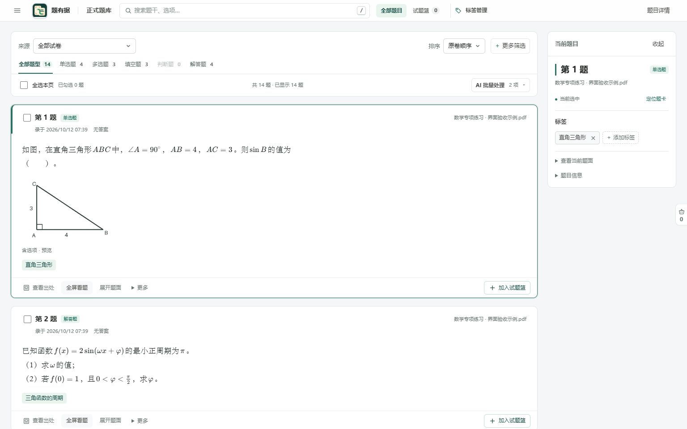
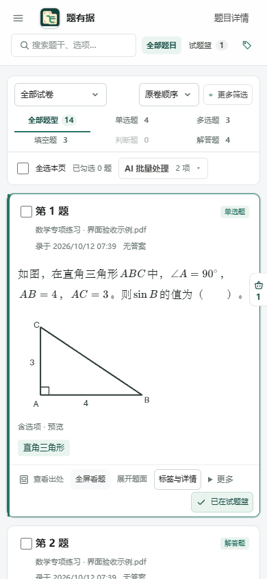
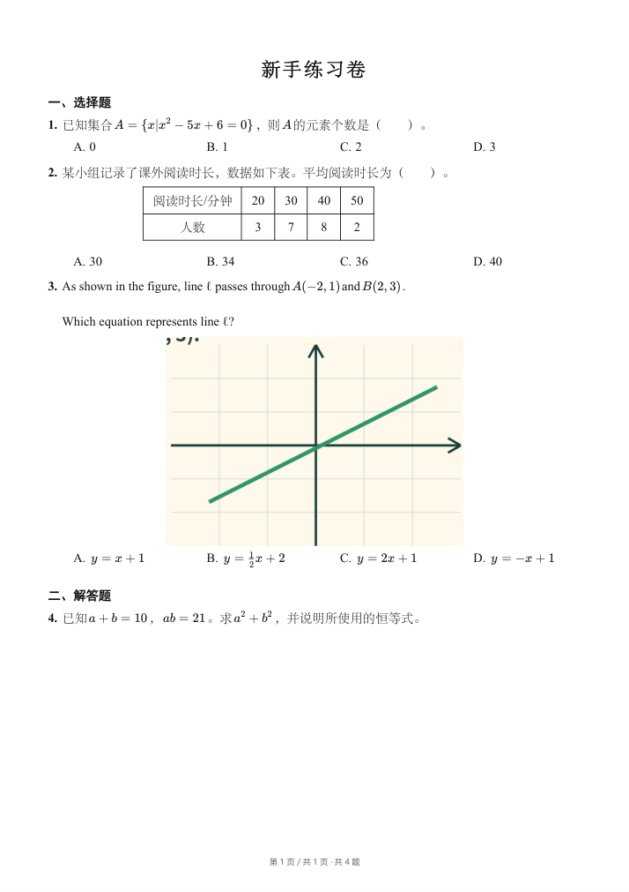

# 题有据 1.21.1 发布验收记录

日期：2026-10-12。基于此前公开 1.18.3 和当前已完成的本地成果，发布顶部查找、题库界面整理和分级标签系统。

## 结果

| 检查 | 结果 |
|---|---|
| 完整后端 | 1661 个不同用例通过；全量中 6 个浏览器可选用例随后单独开启并补齐 |
| Windows 桌面 | 7 组、125 项通过 |
| 前端 | 全部 85 个测试脚本通过 |
| 迁移漂移 | No changes detected |
| 真实旧库升级 | 从 0021 实际迁到 0027，8 项保留与迁移检查通过 |
| 打包版界面 | 4 组通过，1536、1366、390 像素窗口无页面横向溢出 |
| 打包版分级标签 | 7 组通过，包括实际保存、撤销、响应丢失核实、多父级与循环拒绝 |
| 打包版实际 PDF | 4 组通过，实际下载 178177 字节、1 页 A4，4 道题、公式、表格与插图完整 |
| 公开文件与成品审计 | 没有实际题库、密钥、试卷或运行日志进入公开范围 |

桌面检查覆盖启动器、备份、窗口、密钥窗口、打包、助手收尾与快捷方式。额外浏览器检查覆盖真实 Word 公式导出和 Edge/Chrome 生命周期/PDF。

首次完整后端运行的 5 项失败来自旧测试夹具共享功能配置文件，后一个用例读到了前一个用例的设置。仅修复每用例的临时配置位置，保留生产代码和全部断言。该模块单独 34 项通过，随后完整复验通过；首次日志和诊断在本地保留，汇总证据说明此过程。

## 实际成品场景

- 顶部搜索、全部题目、试题篮、标签管理各有唯一入口；左侧栏不常驻，右栏可收起。搜索和 `/` 快捷键、筛选、批量勾选、篮子、全屏与标签浮层正常。
- 分级标签浏览与保存分开，向上/向下替换不改其他关联。父标签直接贴题、后代筛选、多父级管理、撤销与响应丢失去重通过实际服务检查。
- 旧人工题文、解析与入库版本保留；人工标签保留，未核对 AI 转为候选，未知来源等待核对；升级不自动导入层级。
- 离线练习在打包后的 1.21.1 实际执行框题、保存、核对、预览和 PDF 下载。检查全部使用虚构数据，未调用外网 AI，也未写入正式题库。
- 验收浏览器、服务与迁移进程均关闭；私有 PDF 渲染进程清理完成。

配套技能说明已同步为当前契约：切题保存/返回不自动识读，AI 标签先生成候选，再人工采纳。安装包与便携包内的技能文件同当前源码核对一致。

## 交付与边界

发布包括 Windows 安装包、便携包、对应应用与依赖源码、许可证、SHA-256 清单、验收记录、示例截图与实际 PDF 样本。应用使用现有 AGPL-3.0 许可证。

本次没有升级用户当前安装，没有读取实际用户题库或密钥。外部 AI 服务与生成质量未作真实请求验收。教材章节映射、学习状态和有序解法链不包含在本版中。

